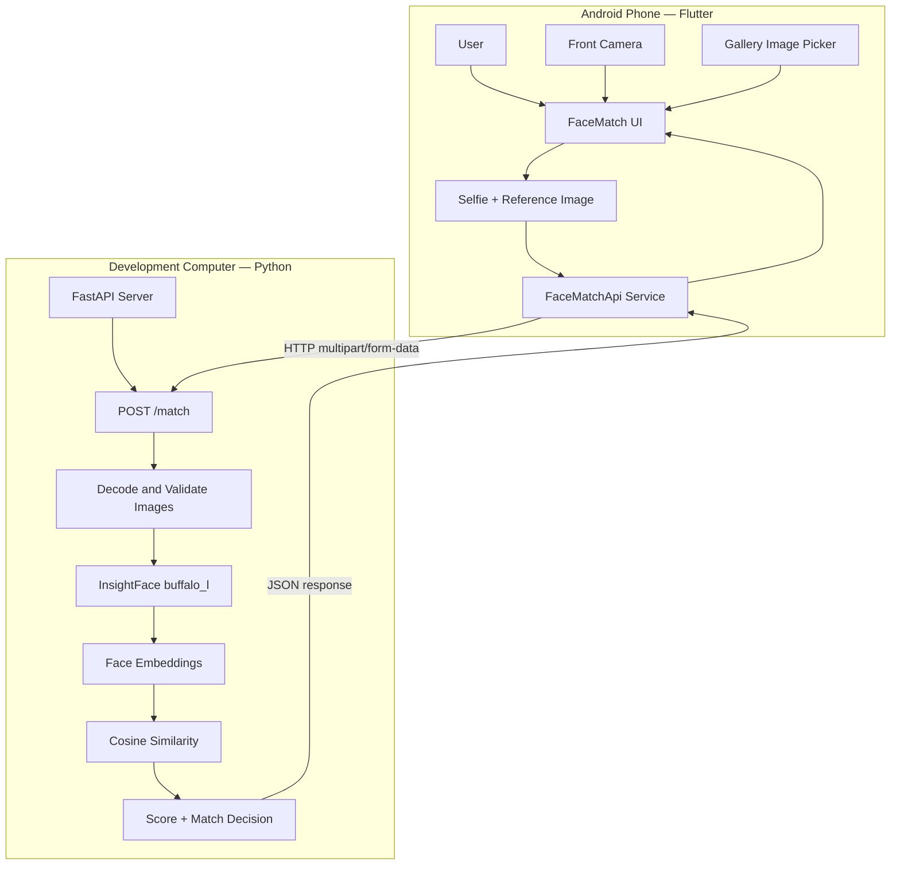

# FaceMatch — Architecture

## Overview

FaceMatch follows a client-server architecture. The Flutter mobile application handles image capture, reference-image selection, and result presentation. A FastAPI backend performs face detection, embedding generation, and similarity calculation.

## Architecture Diagram

## Request Flow

1. The user captures a selfie using the phone's front camera.
2. The user selects a reference image from the gallery.
3. The Flutter application sends both images to `POST /match` as multipart form data.
4. The backend decodes the images and validates that each contains exactly one detectable face.
5. InsightFace generates an embedding for each detected face.
6. The backend calculates cosine similarity between the embeddings.
7. The similarity is converted into a prototype score, and the configured threshold determines `MATCH` or `NO_MATCH`.
8. The API returns a JSON response, which the Flutter app displays.

## Components

| Component | Responsibility |
|---|---|
| Flutter UI | Camera preview, image previews, loading states, errors, and results |
| Camera service | Selfie capture and camera handling |
| Image picker service | Selecting a reference image |
| FaceMatchApi | Multipart request construction and API communication |
| FastAPI | HTTP endpoints and request handling |
| InsightFace | Face detection and embedding generation |
| Similarity calculation | Comparing the two embeddings and calculating the result |

## Deployment Model

During development, the Flutter app runs on an Android device and the backend runs on a development computer. Both must be able to communicate over the network.

The face-analysis model runs on the backend computer's CPU, not directly on the Android phone.

## Error Handling

- Invalid images or face-validation failures produce an HTTP `400` response.
- Unexpected backend failures produce an HTTP `500` response.
- The Flutter application handles API responses and displays the corresponding result or error state.

## Privacy Considerations

The current API handler reads uploaded image bytes into memory for processing. This does not, by itself, establish that all components of the application have zero retention. Any future logging, caching, or storage should be reviewed separately.

Use images with permission, avoid publishing private test images, and do not expose the development API directly to the public internet.